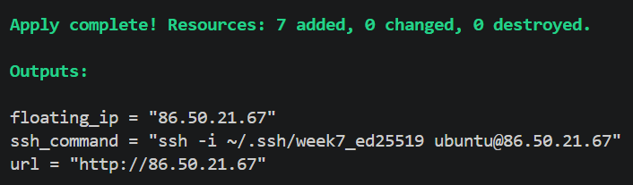
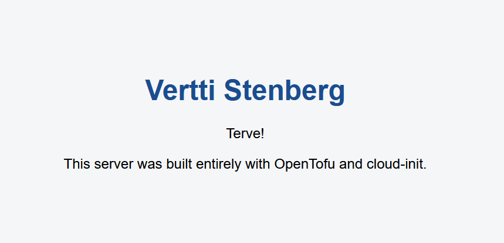
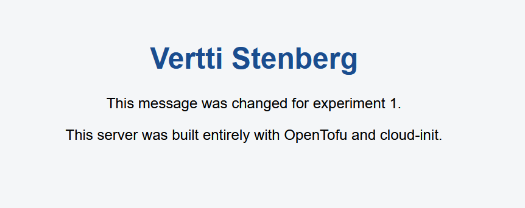
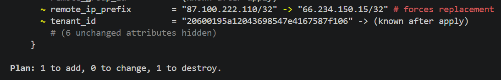
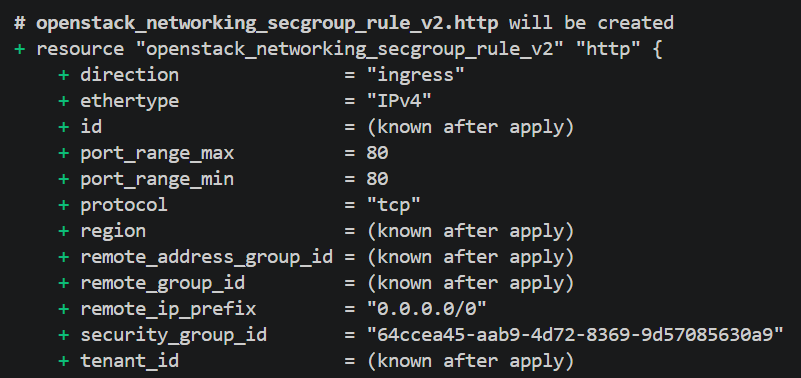
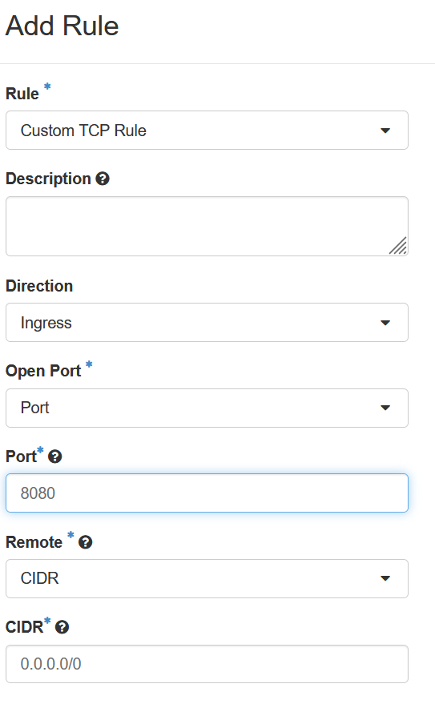
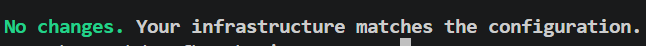
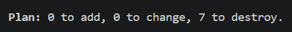
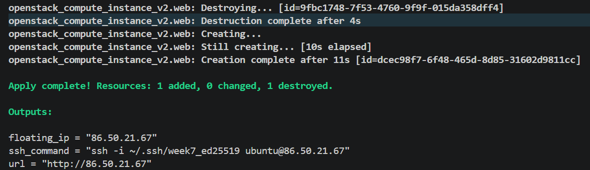

# Week 7: Web server on cPouta with OpenTofu

Repository: https://github.com/verttistenberg/week7-iac-cpouta

## Part A: Questions

### A1. What is Infrastructure as Code, and which problems does it solve?

Infrastructure as Code (IaC) means that servers, networks and firewalls are described in text files instead of being created by clicking through a web interface. The files are stored in Git, and a tool such as OpenTofu reads them and builds the real infrastructure to match. In this week's project, for example, `main.tf` describes the key pair, security group, port, VM and floating IP, and a single `tofu apply` creates all of them.

In Week 1 I built my VM by hand: I clicked through the cPouta launch dialog, chose the image and flavor, set up the security group and floating IP, and then logged in over SSH to install Apache myself. This approach caused several problems. It was not repeatable, because to build the same server again I would have had to remember every click and command. It was also poorly documented, since the only record of my setup was my own notes and screenshots, and nobody could read a file to see how the server was configured. IaC solves these problems because the setup is written down in code, changes are tracked by Git, and the result is identical every time. In Experiment 3 I destroyed everything and rebuilt it in about 2 minutes without clicking anything or logging in over SSH, which would not have been possible with my Week 1 setup.

### A2. Declarative vs. imperative automation, and idempotency

Imperative automation describes how to reach a result, step by step. A shell script that first creates a VM, then logs in over SSH and then runs `apt install apache2` is imperative, and its outcome depends on the state it starts from. If I ran such a script twice, the second run might fail because the VM already exists, or it might create a duplicate. Declarative automation instead describes what the end result should look like, such as "one VM with this firewall and this IP", and the tool works out the necessary steps by comparing the wish with reality. OpenTofu is declarative: my code never says "create the HTTP rule", it says that an HTTP rule on port 80 should exist, and OpenTofu decides whether to create, change or leave it alone.

Idempotency means that running the same operation several times gives the same result as running it once. For example, if I run `tofu apply` again when nothing has changed, OpenTofu reports that there is nothing to do. During the drift experiment I deleted the HTTP rule by hand, and the next `tofu apply` re-created only that one rule and left the other resources untouched. This is important because it makes automation safe to repeat. If an apply is interrupted halfway, I can simply run it again and it continues where it stopped instead of producing duplicates or errors.

### A3. Why was OpenTofu created, and does the choice between Terraform and OpenTofu matter?

OpenTofu was created because of a licensing change. In August 2023 HashiCorp moved Terraform from the open-source MPL 2.0 license to the Business Source License (BSL), which restricts certain commercial uses. Many companies and community members were concerned about depending on a tool controlled by a single vendor, so they forked the last open-source version of Terraform. That fork became OpenTofu, which is now governed by the Linux Foundation and stays under an open-source license with open governance.

The two tools are still very similar. They use the same language and the same providers, and I could replace `tofu` with `terraform` in every command of this exercise. OpenTofu has also added its own features since the fork, such as built-in state file encryption. As a developer, the choice matters little to me, because the skills transfer directly between the two and the code I wrote this week would work with either. For a company it can matter much more, because the license terms, the risk of vendor lock-in, the long-term support and the compatibility with tools it already pays for (for example HashiCorp's commercial cloud services) all affect which one is the safer long-term choice.

### A4. What is the state file used for, and why is it not committed to Git?

The state file (`terraform.tfstate`) is OpenTofu's record of everything it has created. It connects each resource in my code to the real object in cPouta, including its ID and attributes. On every `tofu plan`, OpenTofu compares the code, the state and the real infrastructure to decide what needs to be created, changed or destroyed. My drift experiment shows why this matters: OpenTofu noticed that the HTTP rule I had deleted was missing, because that rule was recorded in the state, but it did not notice the port 8080 rule I added by hand, because that rule was not in the state at all.

The state file should not be committed to a Git repository for three main reasons. First, it can contain sensitive values in plain text, such as keys, IDs and sometimes passwords, and anything committed stays in Git history even if the file is deleted later. Second, Git has no locking, so if two people run `tofu apply` at the same time and both change the state, one version can overwrite the other and the state can be corrupted. Third, the file changes with every apply, which would cause constant merge conflicts. Teams therefore usually keep the state in a remote backend, such as an S3-compatible object storage bucket, Azure Blob Storage, Google Cloud Storage, GitLab or HCP Terraform. These backends give everyone access to the same state, lock it while someone is applying changes, and keep versions and encryption. In this exercise I worked alone, so the state stayed on my laptop and `.gitignore` kept it out of the repository.

## Part B: Write-up

### 1. Overview of the code

#### Files

| File | Purpose |
|---|---|
| versions.tf | Sets the minimum OpenTofu version, the OpenStack provider (~> 3.0) and which cloud in `clouds.yaml` to use. |
| main.tf | Defines all the infrastructure: key pair, security group and rules, port, VM and floating IP. |
| variables.tf | Declares the inputs with descriptions, types, defaults and validation rules. |
| cloud-init.yaml | Configures the VM at first boot: installs Apache and writes my `index.html`. |
| outputs.tf | Prints the floating IP, the page URL and an SSH command after apply. |
| terraform.tfvars.example | Template of the values someone else must provide. My real `terraform.tfvars` is ignored by Git. |
| .gitignore | Keeps credentials (`clouds.yaml`), state files, private keys and personal values out of Git. |
| .terraform.lock.hcl | Records the exact provider version so everyone gets the same one. Committed on purpose. |

#### Resources in main.tf and how they refer to each other

The `data` block looks up the existing project network (it creates nothing). The **security group** holds two rules, **ssh** and **http**, which both point to it with `security_group_id`. The **port** is placed in the project network (from the data block) and uses the security group. The **VM** is attached to the port, uses the **key pair** for SSH and gets its cloud-init file through `user_data`. The **floating IP** is attached to the port, which gives the VM its public address.

#### Dependencies

- network → port
- security group → port
- security group → ssh rule
- security group → http rule
- port → VM
- port → floating IP
- key pair → VM

The arrows show dependencies: the port needs the network and the security group, and the VM and floating IP need the port. That is why OpenTofu creates things in this order and destroys them in the reverse order.

#### Design choices

- **No default for `project_network`, `ssh_allowed_cidr`, `student_name`:** these values are personal or differ for everyone. Without defaults, OpenTofu forces me to set them on purpose. A default for `ssh_allowed_cidr` would be either wrong for other people or dangerously open.
- **Validation rules:** the first checks that `ssh_allowed_cidr` is a valid CIDR with a prefix length (e.g. `/32`), which catches a plain IP address typed without it. The second rejects `0.0.0.0/0`, which would open SSH to the whole internet.
- **Cloud-init ordering:** `write_files` normally runs before packages are installed, so Apache's install could overwrite my page with its default one. `defer: true` delays writing `index.html` until the end of boot, after Apache is installed, so my page is the one shown.

### 2. Deployment

**Prediction:** I would assume there would be seven resources based on the build code. The data block should not be one of them, as it was created by CSC and not OpenTofu.

**Result:**

I forgot to take a screenshot of the first `tofu plan`, so it is missing. The plan shown before the rebuild in Experiment 3 (`recreation.png`) contains the same resources.

### 3. Experiment 1: Change

#### Option A: change the page text

**Prediction:** I predict that the VM will be destroyed and re-created, because every other assignment before this has worked on a similar basis where the backend would have to be deleted so the app would repair itself. I don't think the public IP will change, as it should be the same as the host hasn't changed.

**Result:**

**Explanation:** As I predicted, the VM was destroyed and re-created when the changes were applied. Also, the IP address remained the same. I forgot to take the screenshot of `tofu plan` the first time, so I changed the message back to "terve" afterwards.

#### Option C: update the SSH source address

**Prediction:** For this experiment I will change the site's SSH rule to accept my current Proton VPN IP, when earlier I used my real IP. I predict that the existing SSH rule will be replaced, as the VM is destroyed and recreated after the changes are pushed. I don't think that the old address will work as the whole app is completely remade. The earlier public IP address will be shown in the previous experiment's screenshots.

**Result:**

**Explanation:** My prediction was partly wrong. I expected the VM to be recreated, but the plan only replaced the SSH rule. The VM, port and floating IP were untouched. The provider replaces rules because security group rules can't be edited in place in OpenStack. The old IP no longer works for SSH after the change, since the rule only allows the new address. The site's URL was unchanged, because the floating IP is attached to the port, which the plan never touched.

### 4. Experiment 2: Drift

#### Part 1: deleted rule

**Prediction:** I think the `tofu plan` will not notice, as the rule is changed through an external interface.

**Result:**

**Explanation:** My prediction was wrong, because OpenTofu refreshes the real state during every plan and sees that the rule is missing. `tofu plan` noticed the change, and applying it created a new HTTP rule on port 80.

#### Part 2: added rule

**Prediction:** I predict that `tofu plan` will notice the change as it did in the previous experiment.

**Result:**

**Explanation:** Why OpenTofu reacted differently: manual changes are invisible or temporary. A deleted resource gets silently reverted by the next apply, and an added one stays unnoticed. In both cases the code no longer describes the real environment. OpenTofu detects drift in things it manages, but it cannot see things it doesn't know about, like external manual changes.

### 5. Experiment 3: Destroy and re-create

**Prediction:** I think it will destroy all resources created by code, and won't touch the project network. It will probably destroy the resources in dependency order, as some of the resources depend on each other. The floating IP is defined in the code as a resource (`openstack_networking_floatingip_v2`), so it will also change.

**Result:**

**Explanation:** Destroy order was determined by the references in `main.tf`. The floating IP refers to the port, the VM refers to the port and key pair, the port refers to the security group, and the rules refer to the security group. OpenTofu can't delete something that others still depend on. The network survived because it's declared as a data block, which only reads an existing object. OpenTofu never created it, so it isn't in the state and destroy doesn't touch it. The `floating_ip`, `url` and `ssh_command` outputs are recomputed on every apply. If the address had to stay the same, you would need a fixed address that outlives the VM. The rebuild took about 2 minutes. I can't remember exactly how long the Week 1 version took, but it wasn't more than a few minutes either.

### 6. Reflection: manual (Week 1) vs. code (Week 7)

**Effort:** Building the VM by hand in Week 1 took a few minutes of clicking and SSH commands, but writing the code this week took much longer, including debugging errors and learning the syntax. After that, a full rebuild took one command and about 2 minutes.

**Repeatability:** By hand, I would have to remember every click. With code, my rebuild in Experiment 3 gave an identical server with no manual steps.

**Security:** The code makes secure choices visible and enforceable: SSH is limited to one address and validation rejects `0.0.0.0/0`. But my drift experiment showed that a manual change (the port 8080 rule) can bypass the code without OpenTofu noticing. Credentials also need care, because `clouds.yaml` and the state file must stay out of Git.

**When each makes sense:** A manual setup is fine for a quick one-off test. Code is better for anything that must be rebuilt, shared, reviewed or kept consistent, such as production servers or a team project.

### 7. Problems encountered and solutions

| Problem | Solution |
|---|---|
| Project folder was created in `C:\Windows\System32` (admin terminal) | Moved it to my user folder and used a non-admin terminal |
| `git push` failed with `src refspec main does not match any` | Made the first commit and named the branch `main`, then pushed again |
| I forgot to take a screenshot of the first `tofu plan` | Could not be recovered, so I noted it in section 2 |